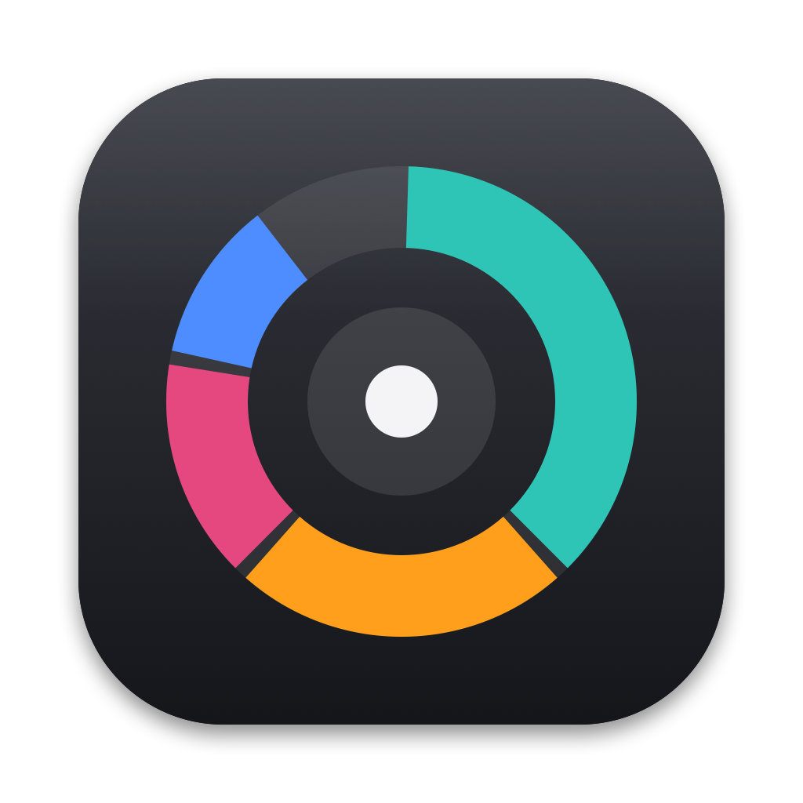
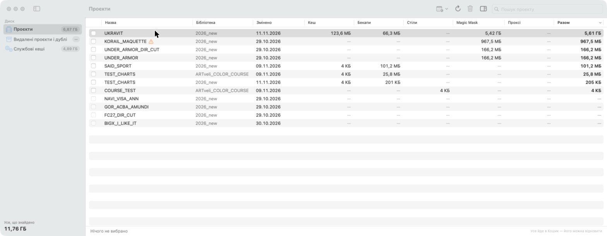

<p align="center">
  
</p>

<h1 align="center">DaVinci Storage</h1>

<p align="center">
  A native macOS app that shows how much disk space every DaVinci Resolve project really takes —<br>
  cache, backups, stills, Magic Mask, proxies — and safely moves what you no longer need to the Trash.
</p>

<p align="center">
  <a href="#english">English</a> · <a href="#українська">Українська</a>
</p>



---

## English

### Why

DaVinci Resolve leaves a lot behind: render cache, project backups, gallery stills, Magic Mask files, proxies and its own service caches. After a few months this easily grows to tens of gigabytes, and disk analyzers such as DaisyDisk only show folders named with random IDs like `585bbd4a-ba19-…` — impossible to tell which project they belong to.

DaVinci Storage reads your Resolve project libraries and links every one of those folders back to a project by name.

### Features

- **Projects** — sortable table of every project in every disk library: last modified date and the space taken by cache, backups, stills, Magic Mask and proxies. Select a row to see each file and folder in the inspector, with *Reveal in Finder*.
- **Mark old projects** — one click selects everything that belongs *only* to projects untouched for 1 / 3 / 6 / 12 months.
- **Deleted projects & duplicates** — leftovers of projects that no longer exist in any library, plus copied Magic Mask folders.
- **Service caches** — Resolve's compiled LUT cache (`.LUT`) and app cache, with an explanation of what is safe to remove.
- **Search, keyboard shortcuts** (⌘R rescan, ⌘⌫ move to Trash), light and dark mode.

### Safety first

- Project databases (`Project.db`, `User.db`) are opened **read-only** and never modified.
- Nothing is deleted — items are **moved to the Trash**, so everything can be restored.
- Cleanup is **disabled while DaVinci Resolve is running**; after Resolve quits the selection is cleared and the disk re-scanned.
- Right before moving anything the app **re-scans** and skips items that changed since you selected them.
- It only touches known DaVinci locations, never anything inside or containing a project library, and follows no symlinks out of them.
- User galleries (PowerGrades) are recognised and never offered for deletion.
- If a library, a project database or the settings can't be read, results are marked **«неточно» (uncertain)**, automatic selection is turned off, and the confirmation sheet warns about every affected item.

### How it links folders to projects

| What | Where | Linked by |
|---|---|---|
| Libraries | `~/Library/Preferences/Blackmagic Design/DaVinci Resolve/dblist.conf` | — |
| Projects | `<library>/Resolve Projects/Users/*/Projects/**/Project.db` | project UUID |
| Render cache | `CacheClip/<UUID>` in the default and project-configured cache folders | project UUID |
| Backups | `Resolve Project Backups/<UUID>` | project UUID |
| Stills | `~/Movies/.gallery/<UUID>`, legacy `.gallery/<still>.dpx` | project / still UUID |
| Magic Mask | paths stored in the project (clip records and *Project Settings → Working Folders*) | path from the project |
| Proxies | `ProxyMedia` / `OptimizedMedia` | folder name (marked uncertain) |

Clip records inside `Project.db` are zstd-compressed; the app uses the system's `libzstd` (Homebrew) when it is installed and otherwise marks Magic Mask results as uncertain.

### Requirements

- macOS 14 or later (developed on macOS 27, Apple Silicon)
- Xcode **Command Line Tools** (Swift 6) — full Xcode is not required
- Optional: `brew install zstd` for exact Magic Mask detection
- DaVinci Resolve with **disk** project libraries (PostgreSQL libraries are not scanned)

### Build & run

```bash
git clone https://github.com/ARTveli/davinci-storage.git
cd davinci-storage
./scripts/build-app.sh          # builds and installs ~/Applications/DaVinci Storage.app
open ~/Applications/"DaVinci Storage.app"
```

Command-line report (no window, nothing is changed):

```bash
swift run davinci-storage report
```

Tests:

```bash
swift test
```

Regenerate the icon: `swift scripts/make-icon.swift`.

### Project layout

```
Sources/StorageCore/       scanning, project reader, analyzer, safe cleaner (no UI)
Sources/davinci-storage/   CLI report
Sources/DaVinciStorageApp/ SwiftUI app
Tests/StorageCoreTests/    Swift Testing suite
docs/                      design spec, implementation plan, decision ledger
scripts/                   app bundle + icon build scripts
```

### Notes

The app is ad-hoc signed for personal use. The interface is in Ukrainian.

---

## Українська

### Навіщо

DaVinci Resolve залишає по собі багато файлів: кеш рендеру, бекапи проєктів, стіли галереї, Magic Mask, проксі та власні службові кеші. За кілька місяців це легко виростає до десятків гігабайтів, а DaisyDisk та схожі програми показують лише папки з випадковими назвами на кшталт `585bbd4a-ba19-…`, і зрозуміти, якому проєкту вони належать, неможливо.

DaVinci Storage читає бази проєктів DaVinci й прив'язує кожну таку папку до проєкту за назвою.

### Можливості

- **Проєкти** — таблиця всіх проєктів з усіх баз на диску: дата останньої зміни та скільки займають кеш, бекапи, стіли, Magic Mask і проксі. Клацни рядок — праворуч з'являться всі файли й папки проєкту з кнопкою «Показати у Finder».
- **Позначити старі** — одним кліком вибирає все, що належить *лише* проєктам, яких не відкривали 1 / 3 / 6 / 12 місяців.
- **Видалені проєкти і дублі** — залишки проєктів, яких уже немає в жодній базі, та скопійовані папки Magic Mask.
- **Службові кеші** — скомпільований кеш LUT (`.LUT`) і кеш програми з поясненням, що безпечно видаляти.
- **Пошук і гарячі клавіші** (⌘R — сканувати знову, ⌘⌫ — у Кошик), світла й темна тема.

### Безпека насамперед

- Бази проєктів (`Project.db`, `User.db`) відкриваються **лише для читання** і ніколи не змінюються.
- Нічого не видаляється назавжди — усе **переміщується в Кошик** і може бути відновлене.
- Поки **DaVinci Resolve відкритий, очищення вимкнене**; після закриття DaVinci вибір скидається, а диск сканується заново.
- Безпосередньо перед переміщенням програма **сканує ще раз** і пропускає все, що змінилося після вибору.
- Програма працює лише з відомими папками DaVinci, ніколи не чіпає бази проєктів і папки, що їх містять, і не переходить за символьними посиланнями.
- Галереї користувача (PowerGrades) розпізнаються й ніколи не пропонуються до видалення.
- Якщо базу, проєкт чи налаштування не вдалося прочитати, результати позначаються **«неточно»**, автовибір вимикається, а вікно підтвердження попереджає про кожен такий об'єкт.

### Як програма знаходить, чиї це папки

| Що | Де | Як прив'язується |
|---|---|---|
| Бази | `~/Library/Preferences/Blackmagic Design/DaVinci Resolve/dblist.conf` | — |
| Проєкти | `<база>/Resolve Projects/Users/*/Projects/**/Project.db` | ID проєкту |
| Кеш рендеру | `CacheClip/<ID>` у стандартній і заданій у проєкті папці кешу | ID проєкту |
| Бекапи | `Resolve Project Backups/<ID>` | ID проєкту |
| Стіли | `~/Movies/.gallery/<ID>`, старий формат `.gallery/<стіл>.dpx` | ID проєкту / стілу |
| Magic Mask | шляхи, записані в проєкті (записи кліпів і *Project Settings → Working Folders*) | шлях із проєкту |
| Проксі | `ProxyMedia` / `OptimizedMedia` | назва папки (позначка «неточно») |

Записи кліпів у `Project.db` стиснуті zstd. Програма використовує системну `libzstd` (з Homebrew), якщо вона встановлена; інакше результати для Magic Mask позначаються «неточно».

### Вимоги

- macOS 14 або новіша (розроблено на macOS 27, Apple Silicon)
- Xcode **Command Line Tools** (Swift 6) — повний Xcode не потрібен
- Бажано: `brew install zstd` для точного визначення Magic Mask
- DaVinci Resolve з базами проєктів **на диску** (бази PostgreSQL не скануються)

### Збирання та запуск

```bash
git clone https://github.com/ARTveli/davinci-storage.git
cd davinci-storage
./scripts/build-app.sh          # збирає й встановлює ~/Applications/DaVinci Storage.app
open ~/Applications/"DaVinci Storage.app"
```

Звіт у Терміналі (без вікна, нічого не змінює):

```bash
swift run davinci-storage report
```

Тести:

```bash
swift test
```

Перемалювати іконку: `swift scripts/make-icon.swift`.

### Структура

```
Sources/StorageCore/       сканування, читання проєктів, аналіз, безпечне очищення (без інтерфейсу)
Sources/davinci-storage/   звіт у Терміналі
Sources/DaVinciStorageApp/ програма на SwiftUI
Tests/StorageCoreTests/    тести (Swift Testing)
docs/                      дизайн, план реалізації, журнал рішень
scripts/                   збирання програми та іконки
```

### Примітки

Програма підписана локально (ad-hoc) для особистого використання. Інтерфейс — українською.

---

<p align="center">
  Made by Artem · artveli.color — colorist, DaVinci Resolve<br>
  <a href="https://www.instagram.com/artveli.color">Instagram @artveli.color</a>
</p>
